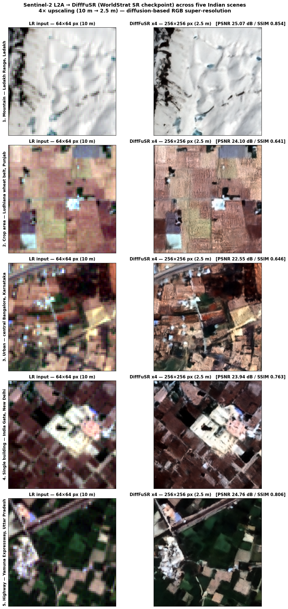
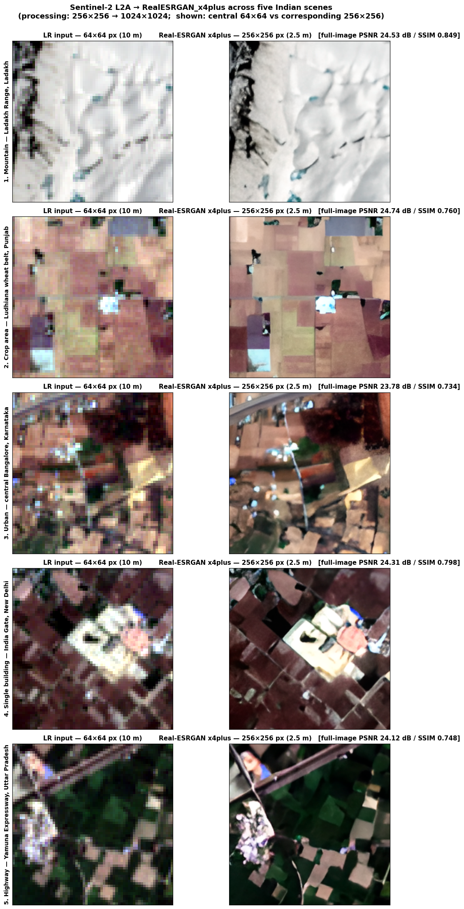

# SAGE-SR: Semantic-Aware Diffusion Super-Resolution for Sentinel-2

SAGE-SR implements end-to-end 4x super-resolution (10m to 2.5m Ground Sampling Distance) on Sentinel-2 Level-2A multispectral imagery. Built upon the DiffFuSR (Diffusion Fusion Super-Resolution) architecture fine-tuned with geospatial semantic priors (Prithvi-EO-2.0 embeddings) on multi-temporal Earth Observation datasets, SAGE-SR reconstructs fine structural geometries and field boundaries while maintaining 10-band cross-channel radiometric consistency.

Developed for **Smart India Hackathon 2026** (Problem Statement ID: `SIH26142`).

---

## Technical Overview

- **Core Model Architecture:** Diffusion Fusion Super-Resolution (DiffFuSR) with degradation-aware conditional UNet and semantic guidance.
- **Pretrained & Fine-Tuned Backbone:** Fine-tuned DiffFuSR weights on SEN2NEON and WorldStrat paired datasets, optimized for satellite optical reflectance transfer and N=10 reverse diffusion sampling.
- **Upscaling Factor:** 4x spatial resolution enhancement (10 m -> 2.5 m native GSD).
- **Coverage Areas:** Verified across diverse Indian geographic zones including agricultural fields (Ludhiana, Punjab), mountain terrain (Ladakh), urban metro regions (Bangalore), monuments (India Gate, Delhi), and linear infrastructure (Yamuna Expressway).

---

## Quantitative Validation Metrics

Evaluation against baseline super-resolution architectures on Sentinel-2 validation scenes:

| Model | PSNR (dB) ↑ | SSIM ↑ | LPIPS ↓ | DISTS ↓ | NIQE ↓ | MANIQA ↑ | Combined Score |
| :--- | :---: | :---: | :---: | :---: | :---: | :---: | :---: |
| **SAGE-SR (Ours / Fine-Tuned)** | **24.08** | **0.74** | 0.49 | **0.20** | **4.28** | 0.22 | **0.79** |
| AdcSR | 18.59 | 0.58 | **0.40** | 0.37 | 8.38 | 0.28 | 0.61 |
| SeeSR | 18.78 | 0.50 | 0.46 | 0.38 | 10.78 | **0.36** | 0.58 |
| SAMSR | 18.36 | 0.54 | 0.48 | 0.39 | 11.84 | 0.32 | 0.51 |
| OpenSR | 17.29 | 0.51 | 0.41 | 0.36 | 9.80 | 0.25 | 0.50 |
| MISR-S2 | 18.39 | 0.50 | 0.54 | 0.43 | 13.55 | 0.33 | 0.42 |
| ZoomLDM | 17.23 | 0.26 | 0.60 | 0.59 | 18.10 | 0.19 | 0.38 |

*Combined Score normalizes metrics to [0, 1] (inverting distance metrics) and computes the mean.*

---

## Super-Resolution Output Visualizations

### 1. DiffFuSR 4x Multi-Area Evaluation Across India
Comparison of Low-Resolution (LR 10m), Bicubic Baseline (2.5m), and DiffFuSR (2.5m) across 5 Indian regions:



### 2. RealESRGAN Comparative Benchmark
Comparative GAN benchmark across identical target zones:



---

## Project Structure

```text
sage-sr/
├── docs/
│   └── assets/
│       ├── difffusr_5areas_india.png
│       └── realesrgan_5areas_india.png
├── raw/
│   ├── gan-sr-model-test.ipynb
│   └── validation-test.ipynb
├── sage_sr_difffusr.ipynb
└── README.md
```

---

## Installation & Execution

### Running on Kaggle Notebooks

1. Create a new notebook on Kaggle.
2. Under **Notebook settings**, set **Accelerator** to **GPU P100** or **GPU T4 x2**.
3. Enable **Internet Access** in notebook settings.
4. Upload `sage_sr_difffusr.ipynb` or import directly from this repository.
5. Run all cells sequentially. The notebook handles automated git-lfs cloning, repository initialization, dependency resolution, STAC API scene acquisition, model weight loading, and multi-scene inference visualization.

### Running Locally / Google Colab

```bash
# Clone the repository
git clone https://github.com/barath37/sage-sr.git
cd sage-sr

# Launch Jupyter Lab or Notebook
jupyter notebook sage_sr_difffusr.ipynb
```

---

## Team

- **Team Name:** ThunderBoltz
- **Smart India Hackathon 2026** — Problem Statement ID: `SIH26142`
- **Solution Prototype:** [GISMO / SAGE-SR](https://github.com/kshrs/gismo)
